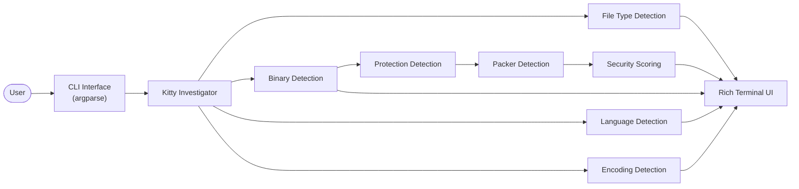
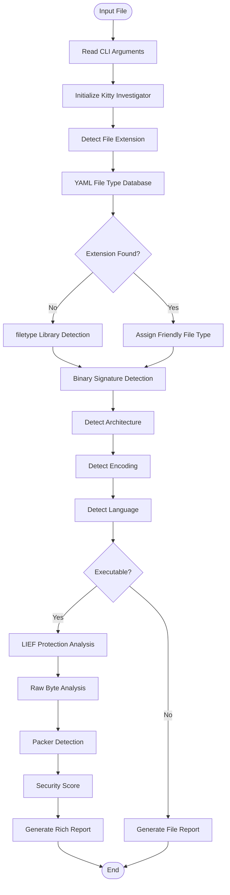

# 🐱 Kitty Inspector


# About

> **Curious Cats Catch Hidden Threats**

Kitty Inspector is a cross-platform binary and file analysis tool written in Python. It helps security researchers, reverse engineers, students, and developers quickly identify file formats, executable types, binary security protections, packers, and programming languages from a single command-line interface.

---

###  File Type Detection

* Detects source code files 
* Uses a YAML-based extension database for easy customization
* Falls back to binary signature detection 

###  Binary Analysis

Supports detection of:

* Windows PE Executables
* Linux ELF Binaries
* macOS Mach-O Executables
* Android APK Packages
* Windows DLLs
* Linux Shared Objects (.so)

###  Archive Detection

Recognizes common archive formats:

* ZIP
* RAR
* 7-Zip
* TAR
* GZIP
* BZIP2

###  Binary Protection Detection

* NX (No Execute)
* ASLR
* PIE
* RELRO
* Stack Canary
* Static / Dynamic Linking
* Stripped Symbols

###  Packer Detection

Detects common executable packers including:

* UPX
* Themida
* VMProtect
* ASPack
* MPRESS
* PECompact

###  Language Detection
Examples include:

* Python
* C
* C++
* Java
* JavaScript
* PHP
* HTML

## Security Score

- Calculates an overall binary security score based on detected protections
---


##  Architecture


---

## Detection Workflow



##  Installation

Clone the repository:

```bash
git clone https://github.com/knightc0de/kitty-inspector.git
cd kitty-inspector
```

Create a virtual environment:

```bash
python -m venv .venv
```

Activate it:

**Windows**

```bash
.venv\Scripts\activate
```

**Linux/macOS**

```bash
source .venv/bin/activate
```

Install dependencies:

```bash
pip install -r requirements.txt
```

---

##  Requirements

* Python 3.10+
* LIEF
* Rich
* PyYAML
* Pygments
* filetype
* colorama

---

## 💻 Usage

Analyze any file:

```bash
python kitty_investigator.py sample.exe
```

Analyze non-executable files:

```bash
python kitty_investigator.py README.md
```

---


## 🤝 Contributing

Contributions are welcome.

If you have ideas, improvements, or bug fixes:

1. Fork the repository
2. Create a new feature branch
3. Commit your changes
4. Submit a Pull Request

---

## 📄 License

This project is licensed under the MIT License.

---

## 👨‍💻 Author

**Puneet Singh**

Cybersecurity Enthusiast • Programmer • Reverse Engineering Learner

GitHub: https://github.com/knightc0de

---

## ⭐ Support

If you found Kitty Inspector useful, consider giving the repository a ⭐ on GitHub. It helps the project reach more developers and security enthusiasts.

---


